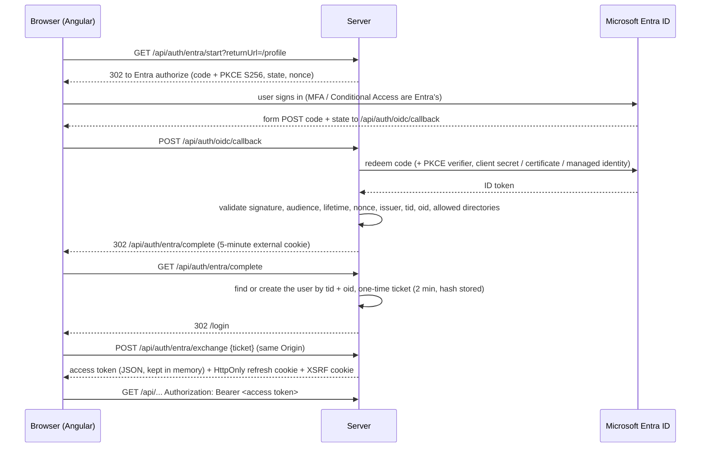

# Azure Entra Starter: reference

Everything beyond the README: how it is built, how to use and configure it, the API and the tests.

## 1. What it does

### 1.1 How sign-in works



1. **Start.** The Angular button navigates to `/api/auth/entra/start`. The server answers with the OpenID Connect
   challenge: authorization code flow with **PKCE (S256)**, `state` and `nonce`, `response_mode=form_post`. Only
   `prompt=login` or `prompt=select_account` are passed through.
2. **Microsoft.** The user signs in at Microsoft. MFA, Conditional Access, passwordless and risk policies are applied
   by **your directory**, not by this application.
3. **Callback.** Microsoft posts the code to `/api/auth/oidc/callback`. The server redeems it (with the PKCE verifier and
   its client credential) and validates the ID token: signature (keys from discovery), audience = client id,
   lifetime, nonce, issuer under the configured authority, **issuer that names the token's own `tid`**, GUID `tid` and
   `oid`, allowed directories, no personal Microsoft accounts.
4. **Complete.** The answer is held for at most 5 minutes in an external cookie. `/api/auth/entra/complete` finds the
   local user **only by `tid` + `oid`** (immutable). The email and name are display data. A new user is created on
   the first sign-in, unless `AutoProvisionUsers=false`. The server then creates a **one-time ticket** (2 minutes, only
   its SHA-256 is stored) and redirects to `/login#ticket=…`. The ticket is in the **fragment**, so it never reaches
   server logs, proxies or the `Referer` header.
5. **Exchange.** The Angular login page removes the fragment from the address bar and history, then posts the ticket to
   `/api/auth/entra/exchange` (same `Origin` required). The answer is the **access token** (ES256 JWT, 10 minutes, kept
   in memory only) plus two `__Host-` cookies: the HttpOnly **refresh** credential and a readable **XSRF** value.
6. **API calls.** The interceptor sends `Authorization: Bearer …` only to relative `/api/` URLs. Every request also
   checks that the token's **session is still live** (not signed out, not revoked, not expired, user not disabled).
7. **Refresh.** On a 401, or a minute before expiry, the client calls `/api/auth/refresh` with the XSRF header. The
   refresh credential **rotates** on every use. A rotated credential used again after 30 seconds is treated as
   **theft** and ends the whole session.
8. **Sign-out.** `/api/auth/logout` revokes the session (the access token stops working at once) and clears the
   cookies. Optionally it also ends the Microsoft session (`SignOutOfMicrosoft`).

### 1.2 Security controls

| Control | Where | Why |
|---|---|---|
| Authorization code + PKCE (S256), `state`, `nonce`, `form_post` | `AuthenticationSetup.cs` | No tokens in the URL; a stolen code cannot be redeemed without the verifier |
| Correlation/nonce cookies `Secure` + `HttpOnly` + `SameSite=None` | `AuthenticationSetup.cs` | Survive Microsoft's cross-site form POST, and only over HTTPS |
| Issuer validated against the authority **and** against the token's `tid` | `EntraSecurity.cs` | With `organizations`/`common`, a token of one directory cannot pose as another |
| `AllowedTenantIds` (required in Production for multi-tenant authorities) | `AuthenticationSetup.cs`, `StartupValidation.cs` | Only your directories sign in |
| Personal Microsoft accounts refused (`AllowPersonalAccounts=false`) | `AuthenticationSetup.cs` | Consumer accounts are not managed by any organization |
| Identity = `tid` + `oid`, never email/UPN | `AuthEndpoints.cs`, `AppDbContext.cs` | Email and UPN can change or be reassigned |
| Coarse error codes only (`sso_denied`, `sso_failed`, …) | `AuthenticationSetup.SsoFailureCode` | The provider's and handler's messages never reach the browser |
| One-time 2-minute ticket in the URL fragment, hash stored, concurrency-checked | `SessionService.cs` | No token in a URL; two parallel exchanges cannot both win |
| Open-redirect guard on `returnUrl` (server and client) | `EntraSecurity.SafeLocalReturnPath`, `safeReturnUrl` | Only local paths |
| Access token: ES256 only, 10 minutes, Authorization header only, memory only | `TokenSigningKeys.cs`, `auth.service.ts` | No `alg` downgrade, no Web Storage, never sent to other origins |
| Live session check on every request | `LiveSessionMiddleware.cs` | Sign-out, revocation and disabled users take effect immediately |
| Refresh credential: `__Host-`, HttpOnly, Secure, SameSite=Strict, rotated, hash stored | `AuthCookies.cs`, `SessionService.cs` | Not readable by scripts, not sent cross-site, useless if the database leaks |
| Refresh reuse detection (30 s grace for other tabs) | `SessionService.RefreshAsync` | A replayed stolen credential ends the session |
| Idle limit (60 min) + absolute limit (12 h) | `Session` options | The user signs in with Microsoft again regularly |
| Origin check + XSRF double-submit on the cookie-authenticated endpoints | `AuthCookies.cs` | `refresh`, `logout` and `exchange` cannot be triggered cross-site |
| Deny by default (fallback policy), `Admin` policy from the Entra app role | `AuthenticationSetup.cs` | A new endpoint is protected unless it opts out |
| Rate limits per IP on sign-in and session endpoints | `RateLimits.cs` | Slows down abuse of the public endpoints |
| No client secret needed: certificate or managed identity (federated credential) | `ClientAssertions.cs` | The safest options keep no shared secret at all |
| Data Protection key ring in SQL, encrypted with a Key Vault key | `DependencyInjection.cs` (Infrastructure) | Several instances share it; the keys are not stored in clear |
| Content-Security-Policy (`script-src 'self'`, `frame-ancestors 'none'`), `nosniff`, `no-referrer` | `SecurityHeaders.cs` | No foreign or inline script can reach the in-memory token; no framing; no URL leaks |
| Production refuses insecure configuration | `StartupValidation.cs` | See [section 9](#9-production-and-deployment) |
| Expired tickets and ended sessions deleted after a day | `SessionCleanupService.cs` | No unbounded growth of sensitive rows |

## 2. Project structure

```text
AzureEntraStarter.slnx                              ← solution (.slnx format)
├─ src/
│  ├─ AzureEntraStarter.Domain/                     ← entities: AppUser, UserSession, RefreshToken, SignInTicket
│  ├─ AzureEntraStarter.Application/                ← options (Entra, Jwt, Session), session models, IClientAssertionProvider
│  ├─ AzureEntraStarter.Infrastructure/             ← implementations
│  │  ├─ Authentication/                            ← TokenSigningKeys (ES256 + JWKS), ClientAssertions (certificate / managed identity)
│  │  ├─ Data/                                      ← AppDbContext, DatabaseSetup, SessionCleanupService, EF Core migrations
│  │  └─ DependencyInjection.cs                     ← AddInfrastructure (database, Data Protection key ring, cleanup)
│  ├─ AzureEntraStarter.Server/                     ← ASP.NET Core (Minimal APIs) + SpaProxy
│  │  ├─ Authentication/                            ← AuthenticationSetup (OIDC + JWT + policies), EntraSecurity (issuer/tid/paths),
│  │  │                                               SessionService (tickets, sessions, refresh), AuthCookies
│  │  ├─ Endpoints/                                 ← AuthEndpoints, SampleEndpoints (protected and Admin-only examples)
│  │  ├─ Middleware/LiveSessionMiddleware.cs        ← sign-out, revocation and disabled users take effect at once
│  │  ├─ Security/                                  ← RateLimits, SecurityHeaders
│  │  ├─ StartupValidation.cs                       ← in Production it refuses to start with an insecure config
│  │  └─ Program.cs
│  ├─ azureentrastarter.client/                     ← Angular 22 (.esproj, aspnetcore-https.js, proxy.conf.js)
│  │  └─ src/app/{core,pages}                       ← auth service, interceptor, guards; login, home, profile, admin, signed-out
│  └─ tests/
│     ├─ AzureEntraStarter.Infrastructure.UnitTests/← signing keys
│     └─ AzureEntraStarter.Server.IntegrationTests/ ← the whole flow against a stand-in Entra token endpoint, plus SQL Server in Docker
├─ deploy/entra/app-roles.json                      ← app roles for the CLI
├─ deploy/github/ci.yml                             ← CI workflow template
├─ docs/                                            ← Word and PDF copies of this README
└─ scripts/                                         ← build-and-test.cmd (every test on Windows), smoke-test.ps1
```

## 3. App roles

The sample administration page and `/api/admin/*` need the Entra **app role** `Admin`.

1. App registration → *App roles → Create app role*: Display name `Admin`, Allowed member types **Users/Groups**,
   Value **`Admin`** (or use `deploy/entra/app-roles.json` with the CLI command above).
2. *Enterprise applications → AzureEntraStarter (dev) → Users and groups → Add user/group*: assign the role.
3. Recommended: *Enterprise applications → Properties → **Assignment required? = Yes***, so only assigned users can
   sign in at all (`az ad sp update --id <application-id> --set appRoleAssignmentRequired=true`).

Roles arrive in the ID token's `roles` claim, are copied into the session and into every access token as `role`
claims. A role removed in Entra applies at the next Microsoft sign-in (at most `Session:MaxSessionHours`). To cut
access at once, disable the user in the application (`POST /api/admin/users/{id}/disabled`).

To protect an endpoint with a role: `.RequireAuthorization(AppRoles.Admin)` (policy) or add your own policy in
`AuthenticationSetup.cs`. In Angular, `roleGuard` with `data: { role: 'Admin' }` only hides pages; the API decides.

## 4. Client credential: secret, certificate or managed identity

`Authentication:Entra:ClientCredentialType` decides how the server proves itself when it redeems the code.

| Type | Use it for | Secret to keep | Configuration |
|---|---|---|---|
| `ManagedIdentity` | **Production on Azure (recommended)** | none | `ManagedIdentityClientId` (empty = system-assigned) |
| `Certificate` | Production outside Azure | the certificate's private key (Key Vault) | `ClientCertificate` (base64 .pfx), `ClientCertificatePassword` |
| `ClientSecret` | Development | the secret (user-secrets / Key Vault), expires | `ClientSecret` |

**Managed identity as a federated credential** (no secret exists anywhere): give the App Service a managed identity,
then on the app registration *Certificates & secrets → Federated credentials → Add credential → "Managed identity"*,
or:

```powershell
az ad app federated-credential create --id <application-id> --parameters '{
  "name": "app-service",
  "issuer": "https://login.microsoftonline.com/<directory-id>/v2.0",
  "subject": "<managed identity object (principal) id>",
  "audiences": ["api://AzureADTokenExchange"] }'
```

The server asks the managed identity for a token for `api://AzureADTokenExchange` and sends it as the
`client_assertion` (RFC 7523). For sovereign clouds set `ManagedIdentityAudience` (for example
`api://AzureADTokenExchangeUSGov`).

**Certificate**: upload the public certificate (.cer) to the app registration; keep the .pfx (RSA ≥ 2048 bits) in Key
Vault and pass it as `Authentication--Entra--ClientCertificate`. The assertion is RS256 with the `x5t` thumbprint
header and lives 5 minutes.

## 5. Angular client

- `core/auth.service.ts`: the session. Token and user in signals, memory only. `initialize()` (app initializer)
  restores the session through the refresh cookie when the XSRF cookie exists. Concurrent refreshes share one request;
  a 204 after another tab rotated the cookie is retried once.
- `core/auth.interceptor.ts`: bearer only for relative `/api/` URLs (never for other origins) and never for the session
  endpoints; on 401 one refresh and one replay, otherwise back to `/login?returnUrl=…`.
- `core/auth.guard.ts`: `authGuard` and `roleGuard` (UX only).
- `pages/login.component.ts`: Microsoft button, "Use another account" (`prompt=select_account`), the ticket exchange
  (the fragment is removed first), and messages for the coarse error codes.
- `index.html` sets `referrer=no-referrer`.

## 6. Configuration reference

### `Authentication:Entra`

| Key | Default | Description |
|---|---|---|
| `Enabled` | `false` | Turns Microsoft sign-in on. When true, the other required keys must be set or the app does not start |
| `Authority` | — | `https://login.microsoftonline.com/<directory-id>/v2.0` (single tenant, recommended). `organizations` = any work account (then `AllowedTenantIds` is required in Production) |
| `MetadataAddress` | empty | Optional discovery URL; must use the authority's host |
| `ClientId` | — | Application (client) ID |
| `ClientCredentialType` | `ClientSecret` | `ClientSecret`, `Certificate` or `ManagedIdentity` |
| `ClientSecret` | empty | Secret. Only with `ClientSecret` |
| `ClientCertificate` / `ClientCertificatePassword` | empty | Secret. Base64 PKCS#12 with private key. Only with `Certificate` |
| `ManagedIdentityClientId` | empty | User-assigned identity's client id; empty = system-assigned |
| `ManagedIdentityAudience` | `api://AzureADTokenExchange` | Federated credential audience |
| `CallbackPath` | `/api/auth/oidc/callback` | Must stay under `/api/` (the dev proxy forwards `/api`) |
| `AllowedTenantIds` | `[]` | Directory ids allowed to sign in (GUIDs). Empty = any directory the authority accepts |
| `AllowPersonalAccounts` | `false` | Allow Microsoft personal accounts (needs a `common`/`consumers` authority). Refused in Production |
| `AutoProvisionUsers` | `true` | Create the local user on first sign-in. `false` = only users already in the `Users` table |
| `SignOutOfMicrosoft` | `false` | Sign-out also ends the Microsoft session (register `https://<host>/signed-out` as redirect URI) |

### `Jwt` (the application's own access tokens)

| Key | Default | Description |
|---|---|---|
| `Issuer` / `Audience` | `AzureEntraStarter` / `AzureEntraStarter.Api` | Claims of the access token |
| `SigningKey` | empty | Secret. P-256 private key, PEM or base64 PKCS#8 (`--generate-signing-key`). Required outside Development |
| `PreviousPublicKeys` | `[]` | Public keys still accepted during a key rotation |
| `AccessTokenMinutes` | `10` | Access token lifetime (1–60) |

### `Session`

| Key | Default | Description |
|---|---|---|
| `RefreshTokenMinutes` | `60` | Idle limit of the refresh credential (5–1440) |
| `MaxSessionHours` | `12` | Absolute session limit after the Microsoft sign-in |
| `ReuseGraceSeconds` | `30` | A just-rotated credential presented again within this window (another tab) is ignored |
| `SignInTicketSeconds` | `120` | Lifetime of the one-time ticket (30–300) |

### Others

| Key | Default | Description |
|---|---|---|
| `ConnectionStrings:Default` | LocalDB in Development | SQL Server / Azure SQL. With Entra authentication: `Authentication=Active Directory Default` |
| `Database:Provider` | `SqlServer` | `SqlServer` or `InMemory` (tests only) |
| `Database:MigrateOnStartup` | `true` in Development | Must be `false` in Production (run migrations from the pipeline) |
| `DataProtection:KeyVaultKeyId` | empty | Key Vault key that encrypts the key ring stored in SQL. Required in Production |
| `RateLimits:AuthPerMinute` / `SessionPerMinute` | `20` / `60` | Per-IP limits on sign-in and session endpoints |

Environment variables use `__` (for example `Authentication__Entra__ClientId`). In App Service, Key Vault references
work for every secret (`@Microsoft.KeyVault(SecretUri=...)`).

## 7. API

| Method and path | Access | Description |
|---|---|---|
| `GET /api/auth/config` | anonymous | `{ entraEnabled }` |
| `GET /api/auth/entra/start?returnUrl=&prompt=` | anonymous, rate limited | Starts the Microsoft sign-in |
| `POST /api/auth/oidc/callback` | Microsoft | Handled by the OpenID Connect handler |
| `GET /api/auth/entra/complete` | external cookie | Creates the one-time ticket, redirects to `/login#ticket=` |
| `POST /api/auth/entra/exchange` | same Origin, rate limited | `{ ticket }` → `{ accessToken, expiresAtUtc, sessionExpiresAtUtc, user }` + cookies |
| `POST /api/auth/refresh` | refresh cookie + Origin + XSRF | 200 new access token; 204 no session |
| `POST /api/auth/logout` | Origin + XSRF when a session cookie exists | `{ microsoftSignOutUrl }` |
| `GET /api/auth/me` | session | The signed-in user and roles |
| `GET /api/sample/hello` | session | Example of a protected endpoint |
| `GET /api/admin/users`, `POST /api/admin/users/{id}/disabled` | role `Admin` | Example of a role-protected endpoint |
| `GET /.well-known/jwks.json` | anonymous | Public keys of the access tokens (for other services) |
| `GET /health/ready` | anonymous | Database readiness |

Any other `/api/...` path requires a session (401) and then answers 404.

## 8. Tests

`scripts\build-and-test.cmd` runs everything on Windows: the build (warnings as errors), the .NET tests (Docker is
required for the SQL Server tests), the Angular tests, the Angular production build and the real-server smoke test.

| Project | Command | Covers |
|---|---|---|
| `AzureEntraStarter.Infrastructure.UnitTests` (3) | `dotnet test AzureEntraStarter.slnx` | ES256 signing keys: a PEM or base64 P-256 key signs and its public key is published, previous public keys keep validating during a rotation, bad keys stop the application. |
| `AzureEntraStarter.Server.IntegrationTests` (125) | same | The full round trip against a stand-in Entra token endpoint (ID tokens signed by its own key), every refusal (other directory, not allowed, personal account, issuer/tid mismatch, other audience, expired, other key, replayed nonce, cancelled, bad code, missing correlation), tickets (once, expiry, concurrency, Origin), sessions (rotation, reuse detection, idle and absolute limits, sign-out, disabled users), authorization (deny by default, roles, forged/HS256/`none` tokens, token from another user), the three client credentials (the certificate assertion is verified like Entra does), configuration validation. |
| ↳ containers | same (Docker) | **SQL Server 2022**: migrations, the full flow, two instances sharing one database. |
| `azureentrastarter.client` (32) | `npm run test:ci` | Karma + ChromeHeadless: app shell, auth service, interceptor, guards, login page and the other pages. |
| Real server | `scripts\smoke-test.ps1` | Publishes; Production refuses insecure configuration; then the real server over HTTPS with LocalDB **against the real Microsoft Entra endpoints** (discovery from `login.microsoftonline.com`; with the Azure CLI signed in, your own directory id). It checks the redirect to Microsoft's authorize endpoint and Microsoft's own answer, without creating anything in your directory. |

## 9. Production and deployment

Production **refuses to start** unless: Entra is enabled and configured; a multi-tenant authority has
`AllowedTenantIds`; personal accounts are off; `Jwt:SigningKey` is set; SQL Server with a connection string and
`MigrateOnStartup=false`; `DataProtection:KeyVaultKeyId` is set.

Checklist for Azure App Service:

1. App registration for production: redirect URI `https://<your-host>/api/auth/oidc/callback`, **Assignment
   required = Yes**, app roles assigned, and a **federated credential for the App Service managed identity**
   (`ClientCredentialType=ManagedIdentity`).
2. Key Vault: secret `Jwt--SigningKey`, a key for Data Protection; grant the managed identity *Key Vault Secrets User*
   and *Key Vault Crypto User*.
3. Azure SQL with Entra authentication (`Authentication=Active Directory Default`), the managed identity as a database
   user (`db_datareader`, `db_datawriter`).
4. Migrations from the pipeline: `dotnet ef migrations bundle -p src/AzureEntraStarter.Infrastructure -s src/AzureEntraStarter.Server -o efbundle.exe` and run it
   with the connection string of a deployment identity.
5. Behind a reverse proxy (including App Service on Linux, if not already set) set
   `ASPNETCORE_FORWARDEDHEADERS_ENABLED=true` so the redirect URI uses the public scheme and host. If a proxy changes
   the `Host` header (for example Azure Front Door), make it forward the original host so the redirect URI matches.
6. Several instances: the Data Protection key ring and the sessions are in SQL, so the sign-in can start on one
   instance and finish on another (tested with two instances on one database).
7. HTTPS only, `AllowedHosts` set to your host names.
8. Copy `deploy/github/ci.yml` to `.github/workflows/ci.yml`.

### 9.1 Publish

```cmd
dotnet publish src\AzureEntraStarter.Server -c Release -o publish
```

The `.esproj` runs `npm run build` and the publish copies the Angular app into `wwwroot`.
